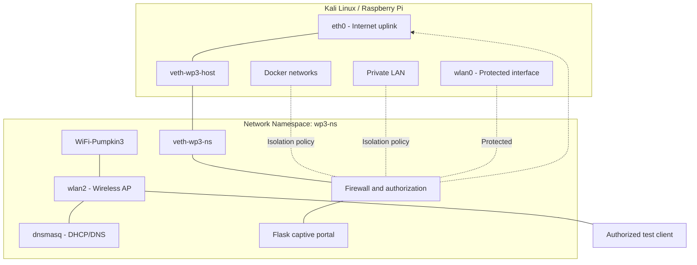
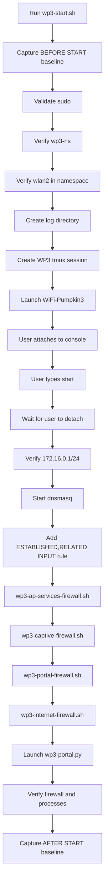
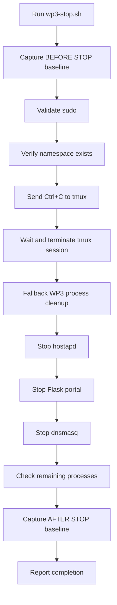
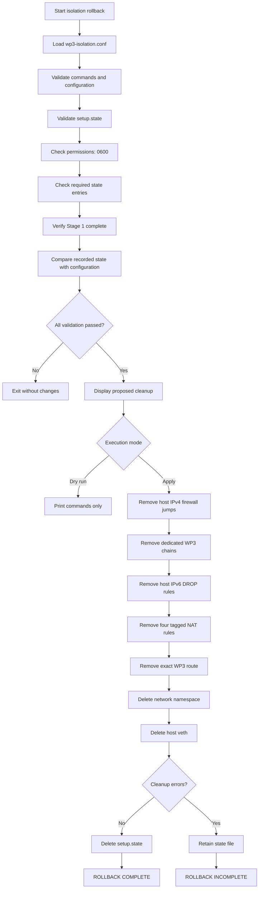

# WiFi-Pumpkin3 (WP3) — Architecture and Script Documentation

**Platform:** Kali Linux on Raspberry Pi  
**Project directory:** `/home/kali/wifipumpkin3`  
**Network namespace:** `wp3-ns`  
**Documentation status:** Initial architecture review — 21 November 2026

---

## 1. Project overview

The WP3 setup is organized into six functional areas:

1. Preparation and configuration
2. Network isolation infrastructure
3. Access point and DHCP/DNS services
4. Firewall and client authorization
5. Captive portal
6. Runtime lifecycle management and diagnostics

The architecture deliberately separates the WP3 application lifecycle from the underlying network isolation infrastructure.

**Important operational principle:** Starting or stopping WP3 should not create or destroy the network namespace, virtual interfaces, routes or isolation firewall infrastructure.

---

## 2. High-level architecture



*Conceptual topology based on the configuration and scripts reviewed. Actual packet forwarding and firewall behaviour still require verification.*

### 2.1 Network configuration

| Component | Value |
|---|---|
| AP interface | `wlan2` |
| Internet uplink | `eth0` |
| Protected interface | `wlan0` |
| Namespace | `wp3-ns` |
| Host veth | `veth-wp3-host` |
| Namespace veth | `veth-wp3-ns` |
| AP subnet | `172.16.0.0/24` |
| AP gateway | `172.16.0.1` |
| AP netmask | `255.255.255.0` |
| AP broadcast | `172.16.0.255` |
| DHCP pool | `172.16.0.100–172.16.0.150` |
| Transit subnet | `169.254.250.0/30` |
| Host transit IP | `169.254.250.1` |
| Namespace transit IP | `169.254.250.2` |
| DNS forwarders | `1.1.1.1`, `8.8.8.8` |

### 2.2 Protected networks

The central configuration identifies:

- Docker: `172.17.0.0/16`, `172.18.0.0/16`, `172.19.0.0/16`
- Private LAN: `192.168.0.0/24`
- Protected physical interfaces: `eth0`, `wlan0`

These protections must remain intact during future modifications.

---

## 3. Central configuration

### `wp3-isolation.conf`

This is intended to be the central configuration for the isolation toolkit.

| Lines | Section | Responsibility |
|---|---|---|
| 7–13 | Network interfaces | AP, uplink and protected interfaces |
| 15–21 | Namespace | Namespace and virtual Ethernet names |
| 23–34 | AP | SSID, channel, subnet, gateway and DHCP range |
| 36–41 | Transit | Host-to-namespace transit network |
| 43–50 | Docker | Protected Docker networks |
| 52–57 | Private LAN | Protected LAN subnets |
| 59–68 | Security | Internet authorization, LAN blocking and IPv6 isolation |
| 70–82 | Captive portal | Portal and authorized testing capabilities |
| 84–89 | BeEF | BeEF port and management restriction |
| 91–98 | Safety | Confirmation and preservation controls |
| 100–103 | Runtime paths | State and log directories |
| 105–108 | Initial state | Setup and runtime flags |

**Configuration concern:** Some AP values are duplicated in `wp3-configure-dhcp.sh` and other operational scripts. The intended future design is to use `wp3-isolation.conf` as the authoritative configuration source.

---

## 4. Script inventory

### 4.1 Preparation and configuration

| Script | Responsibility |
|---|---|
| `wp3-preflight.sh` | Preliminary system and interface readiness checks |
| `wp3-configure-dhcp.sh` | Network conflict checks and DHCP configuration |
| `wp3-audit.sh` | Broader system and network audit |

### 4.2 Network isolation

| File | Responsibility |
|---|---|
| `wp3-isolation.conf` | Central isolation configuration |
| `wp3-isolation-preflight.sh` | Checks prerequisites before isolation setup |
| `wp3-isolation-setup.sh` | Creates namespace, virtual links, routes and isolation infrastructure |
| `wp3-isolation-rollback.sh` | Reverses isolation setup and restores previous state |

### 4.3 Runtime services and firewall

| Script | Responsibility |
|---|---|
| `wp3-dnsmasq-start.sh` | Starts DHCP/DNS inside the namespace |
| `wp3-ap-services-firewall.sh` | AP-side DHCP and DNS firewall allowances |
| `wp3-internet-firewall.sh` | Internet forwarding and authorization policy |
| `wp3-authorize.sh` | Adds client authorization |
| `wp3-revoke.sh` | Removes client authorization |
| `wp3-captive-firewall.sh` | Captive HTTP redirection rules |
| `wp3-portal-firewall.sh` | Explicit portal access rules |

### 4.4 Captive portal

| File | Responsibility |
|---|---|
| `wp3-portal.py` | Flask captive portal application |
| `wp3-portal-start.sh` | Alternative/manual portal launcher |

### 4.5 Lifecycle and diagnostics

| Script | Responsibility |
|---|---|
| `wp3-start.sh` | Main runtime startup orchestrator |
| `wp3-stop.sh` | Stops application services |
| `wp3-verify.sh` | Independent operational verification |
| `wp3-capture-baseline.sh` | Captures diagnostic snapshots |

### 4.6 Core software patch

| File | Responsibility |
|---|---|
| `wp3-core-20261120.patch` | Changes to installed WP3 Python source |
| `wp3-core-20261120.patch.sha256` | Patch integrity checksum |

The core patch is separate from the operational scripts.

---

## 5. Startup architecture

### Main orchestrator: `wp3-start.sh`

The startup script is executed as the normal `kali` user.



### 5.1 Detailed startup sequence

| Order | Operation | Implementation |
|---|---|---|
| 1 | Capture before snapshot | `wp3-capture-baseline.sh` |
| 2 | Authenticate sudo | `sudo -v` |
| 3 | Verify namespace | `ip netns list` |
| 4 | Verify wireless interface | `ip netns exec wp3-ns ip link show wlan2` |
| 5 | Create log directory | `/var/log/wp3` |
| 6 | Launch WP3 | tmux session `wp3` |
| 7 | Start AP | User enters `start` |
| 8 | Verify AP gateway | `172.16.0.1/24` |
| 9 | Start DHCP/DNS | `wp3-dnsmasq-start.sh` |
| 10 | Permit return traffic | INPUT `ESTABLISHED,RELATED` |
| 11 | AP firewall | `wp3-ap-services-firewall.sh` |
| 12 | Captive redirection | `wp3-captive-firewall.sh` |
| 13 | Portal firewall | `wp3-portal-firewall.sh` |
| 14 | Internet policy | `wp3-internet-firewall.sh` |
| 15 | Start Flask portal | `wp3-portal.py` |
| 16 | Verify and snapshot | Firewall, process and baseline checks |

### 5.2 User interaction

The current startup procedure requires:

1. Run `bash ~/wifipumpkin3/wp3-start.sh`.
2. Press ENTER to attach to WP3.
3. Type `start`.
4. Wait until the AP starts.
5. Detach using Ctrl+B followed by D.
6. Allow the startup script to resume.

---

## 6. Shutdown architecture

### Main shutdown script: `wp3-stop.sh`



### 6.1 Services stopped

- WiFi-Pumpkin3
- hostapd
- Flask portal
- dnsmasq
- WP3 tmux session

### 6.2 Infrastructure preserved

- Network namespace
- Virtual Ethernet interfaces
- Routes
- Firewall rules
- Authorization state

**Important:** `wp3-stop.sh` does not delete `wp3-ns` or execute the isolation rollback script.

This allows WP3 to be stopped and restarted without recreating the underlying network isolation infrastructure.

---

## 7. Firewall architecture

The startup script currently applies firewall components in this order:

| Order | Firewall operation | Purpose |
|---|---|---|
| 1 | INPUT established/related | Allows established return traffic |
| 2 | AP services firewall | DHCP and DNS traffic |
| 3 | Captive firewall | HTTP redirection |
| 4 | Portal firewall | Explicit portal access |
| 5 | Internet firewall | Forwarding and authorization |

### Authorization model

The internet firewall creates and uses the `WP3_AUTH` chain.

The authorization scripts operate on that chain:

- `wp3-authorize.sh` adds authorization.
- `wp3-revoke.sh` removes authorization.

The exact rule semantics, insertion positions and NAT dependencies still need a detailed rule-by-rule review.

---

## 8. Baseline and logging architecture

The project uses a dedicated baseline capture utility:

`wp3-capture-baseline.sh`

It is called automatically:

- Before startup
- After startup
- Before shutdown
- After shutdown

The project also maintains runtime logs under `/var/log/wp3`.

Known log files include:

| Log | Purpose |
|---|---|
| `wifipumpkin3.log` | WP3 console output |
| `hostapd-debug.log` | hostapd output |
| `portal.log` | Flask captive portal output |
| `dnsmasq` log | DHCP/DNS diagnostic output |

These logs are important for diagnosing AP failures, DHCP assignment problems, DNS failures and portal behaviour.

---

## 9. Backup files

Historical backups currently include:

- `wp3-isolation-setup.sh.bak-before-transit`
- `wp3-isolation-rollback.sh.bak-before-transit`
- `wp3-ap-services-firewall.sh.bak-before-dns-replies`
- `wp3-portal.py.bak-before-captive-detection`
- `wp3-portal.py.bak-before-redirect-fix`
- `wp3-portal.py.bak-20261120-1608`
- `wp3-start.sh.bak-before-tmux`
- `wp3-stop.sh.bak-before-tmux`
- `wp3-start.sh.bak-before-dns-order-20261121-112200`
- `wp3-start.sh.bak-before-dns-order-20261121-112356`

These are historical copies, not part of the current normal startup sequence.

They should be retained until the current versions have been fully validated and the backup history documented.

---

## 10. Core WP3 source patch

`wp3-core-20261120.patch` contains modifications to the installed Python package.

The patch includes:

1. EOF handling in `terminal.py`.
2. Missing active DHCP service/reactor protection in `dhcpcontroller.py`.
3. Removal of broad iptables cleanup operations from the WP3 kill list in `wirelessmodecontroller.py`.
4. Null checking in `static.py`.
5. Synchronous cleanup and interface command execution in `static.py`.
6. Persistent hostapd stdout logging in `threads.py`.

The patch checksum was validated, and a reverse dry-run against the installed source succeeded.

The operational shell scripts are deliberately maintained separately from this patch.

---

## 11. Items requiring further investigation

The following items are not yet fully verified. They should not be treated as confirmed defects.

| Priority | Item | Required investigation |
|---|---|---|
| High | Isolation preflight | Inspect all checks and side effects |
| High | Isolation setup | Verify namespace, interface movement, routes and firewall creation |
| High | Isolation rollback | Verify restoration and safety checks |
| High | Firewall rules | Inspect individual chains, ordering and overlapping rules |
| Medium | Configuration ownership | Determine whether isolation scripts actually source `wp3-isolation.conf` |
| Medium | DHCP configuration | Remove duplicated hardcoded AP settings |
| Medium | SSID | Reconcile configured SSID with actual WP3 SSID |
| Medium | State flags | Determine whether setup flags are updated at runtime |
| Medium | Portal process detection | Verify process detection inside the namespace |
| Medium | Authorization | Audit exact authorize/revoke rule behaviour |
| Low | Historical backups | Identify obsolete versions and archive them |

---

---

# 12. Isolation Rollback Architecture

**Script:** `wp3-isolation-rollback.sh`  
**Reviewed:** 21 November 2026  
**Source reviewed:** Complete 325-line script

## A1. Purpose

The isolation rollback script reverses a completed WP3 Stage 1 network isolation setup.

It is deliberately separate from `wp3-stop.sh`.

- `wp3-stop.sh` stops the WP3 application and runtime services while preserving the isolation infrastructure.
- `wp3-isolation-rollback.sh` dismantles the WP3 isolation infrastructure and removes its associated network resources.

**Important limitation:** The rollback script only supports a completed Stage 1 setup recorded in its state file. It does not attempt recovery from an interrupted setup without a completed state file.

## A2. Execution modes

| Command | Behaviour |
|---|---|
| `sudo bash wp3-isolation-rollback.sh` | Dry run; default |
| `sudo bash wp3-isolation-rollback.sh --apply` | Execute rollback |
| Any other argument | Displays usage and exits |

The script prints proposed cleanup commands in both modes but executes them only in APPLY mode.

## A3. Configuration and prerequisites

The script loads:

`wp3-isolation.conf`

Required configuration values:

- `WP3_NETNS`
- `VETH_HOST`
- `VETH_NS`
- `UPLINK_INTERFACE`
- `WP3_SUBNET`
- `TRANSIT_HOST_IP`
- `TRANSIT_NS_IP`
- `WP3_STATE_DIR`

It requires:

- `ip`
- `iptables-legacy` or `iptables`
- `ip6tables-legacy` or `ip6tables`

The state file is:

`/var/lib/wp3-isolation/setup.state`

The actual path is determined by `WP3_STATE_DIR` in the configuration.

## A4. State-file safety checks

Before cleanup, the script performs these checks:

1. State file must exist.
2. File permissions must be exactly `0600`.
3. Required state entries must be present.
4. `WP3_SETUP_STAGE1` must equal `complete`.
5. Recorded namespace, veth, uplink, subnet and transit IP values must match the current configuration.
6. Recorded firewall chain names and NAT identifiers must match the expected WP3 values.
7. Recorded IPv6 and NAT rule flags must match the expected value of `1`.

The state file is parsed as key/value data and is not executed as shell code.

If validation fails, the script exits without performing cleanup.

## A5. Rollback operation sequence

### Step 1 — Host IPv4 firewall cleanup

Removes the WP3-specific firewall jumps:

- INPUT jump to `WP3_ISO_IN`.
- FORWARD jump to `WP3_ISO_FWD` for outgoing host veth traffic.
- FORWARD jump to `WP3_ISO_FWD` for incoming host veth traffic.

Then removes the dedicated chains:

- `WP3_ISO_IN`
- `WP3_ISO_FWD`

A chain is removed only if it has no remaining references.

### Step 2 — Host IPv6 firewall cleanup

Removes the WP3-specific IPv6 DROP rules:

- INPUT traffic arriving through `veth-wp3-host`.
- FORWARD traffic arriving through `veth-wp3-host`.
- FORWARD traffic leaving through `veth-wp3-host`.

### Step 3 — Host NAT cleanup

Removes four specifically tagged MASQUERADE rules:

| Comment identifier | Traffic |
|---|---|
| `WP3_ISOLATION_NAT` | AP subnet through uplink |
| `WP3_ISOLATION_DNS_UDP` | Namespace DNS over UDP |
| `WP3_ISOLATION_DNS_TCP` | Namespace DNS over TCP |
| `WP3_ISOLATION_TRANSIT_NAT` | Namespace transit traffic |

The script checks for each exact rule before deleting it.

### Step 4 — Host route cleanup

Checks for the exact WP3 route:

`172.16.0.0/24 via 169.254.250.2 dev veth-wp3-host`

Deletes it only when the recorded route matches the expected configuration.

If the route is already absent, it reports that no route was removed.

### Step 5 — Network namespace cleanup

Checks whether `wp3-ns` exists.

If present, executes:

`ip netns del wp3-ns`

If absent, reports that the namespace is already absent.

### Step 6 — Host virtual Ethernet cleanup

Checks whether `veth-wp3-host` exists.

If present, executes:

`ip link del veth-wp3-host`

The namespace-side veth is expected to disappear with namespace deletion.

### Step 7 — State-file handling

After cleanup:

- If APPLY mode is active and no errors occurred, removes `setup.state`.
- If cleanup errors occurred, retains the state file for investigation.
- In DRY RUN mode, retains the state file.

## A6. Rollback architecture diagram



## A7. Resource cleanup matrix

| Resource | Rollback action |
|---|---|
| `WP3_ISO_IN` | Remove if unreferenced |
| `WP3_ISO_FWD` | Remove if unreferenced |
| Host IPv4 INPUT jump | Delete exact WP3 rule |
| Host IPv4 FORWARD jumps | Delete exact WP3 rules |
| Host IPv6 INPUT rule | Delete exact WP3 rule |
| Host IPv6 FORWARD rules | Delete exact WP3 rules |
| WP3 NAT rules | Delete four tagged rules |
| WP3 host route | Delete exact matching route |
| `wp3-ns` | Delete namespace |
| `veth-wp3-host` | Delete host-side veth |
| `setup.state` | Delete only after successful cleanup |

### Explicitly observed preservation behaviour

The rollback script does not contain explicit commands to:

- Flush all host firewall tables.
- Delete Docker networks.
- Delete protected physical interfaces.
- Reset the complete host firewall configuration.

This is a selective cleanup implementation, not a general network reset utility.

## A8. Error handling and recovery

The script uses a global `ERRORS` counter.

Each cleanup command is printed and, in APPLY mode, executed. A non-zero command result increments the counter.

Final outcomes:

| Outcome | Result |
|---|---|
| Dry run | `DRY RUN COMPLETE — no changes were made.` |
| APPLY with zero errors | `ROLLBACK COMPLETE.` |
| APPLY with errors | `ROLLBACK INCOMPLETE` and exit code 1 |

The state file is retained when cleanup errors occur, allowing investigation before another rollback attempt.

**Recovery limitation:** The presence of the state file does not guarantee that every resource remains in its original state after a partial rollback. Inspect the actual network, firewall and namespace state before retrying.

## A9. Relationship with other lifecycle scripts

| Script | Operational responsibility |
|---|---|
| `wp3-start.sh` | Starts WP3 application and AP services |
| `wp3-stop.sh` | Stops WP3 runtime services; preserves isolation |
| `wp3-isolation-preflight.sh` | Checks isolation setup prerequisites |
| `wp3-isolation-setup.sh` | Establishes Stage 1 isolation infrastructure |
| `wp3-isolation-rollback.sh` | Removes completed Stage 1 isolation infrastructure |

Recommended operational sequence:

1. Use `wp3-stop.sh` to stop WP3 services.
2. Run rollback in default DRY RUN mode.
3. Review every proposed cleanup command.
4. Use `--apply` only when intentional infrastructure removal is required.
5. Verify host connectivity, firewall rules, routes and namespace state afterward.

## A10. Technical review notes

The following points should be checked against the setup script before declaring the setup/rollback pair fully validated:

1. Verify every resource created by setup has a corresponding rollback action.
2. Verify namespace deletion behaviour when processes are still running.
3. Verify cleanup behaviour when one or more commands fail.
4. Review the global `ERRORS` counter interaction in `remove_dedicated_chain()`.
5. Verify that partial rollback does not leave an ambiguous state that prevents safe recovery.
6. Verify that the state file records all resources actually created by setup.

## A11. Documentation status

**Rollback script:** Fully inspected, lines 1–325.

**Verified:** State validation, dry-run/apply behaviour, selective IPv4 and IPv6 firewall cleanup, tagged NAT cleanup, exact route removal, namespace deletion, host veth deletion, state-file retention and final status reporting.

**Pending:** Cross-validation against `wp3-isolation-setup.sh` and live verification of the rollback recovery procedure.

---
## 12. Planned improvements

### Phase 1 — Documentation
- Document firewall rule dependencies.
- Produce a definitive execution/dependency map.

### Phase 2 — Configuration consistency
- Make `wp3-isolation.conf` the central configuration source.
- Make `wp3-configure-dhcp.sh` interactive.
- Retain fixed AP subnet and gateway initially.
- Prompt for wireless interface, DHCP pool and lease settings.
- Preserve all existing safety checks and atomic updates.

### Phase 3 — Operational hardening
- Review startup and shutdown error handling.
- Improve process detection.
- Validate firewall idempotency.
- Confirm logging and recovery procedures.

### Phase 4 — Final documentation
- Produce a deployment procedure.
- Produce a startup/shutdown runbook.
- Produce an isolation recovery procedure.
- Maintain patch versions and checksums.

---

## 13. Current operational status

As of 21 November 2026:

- Network isolation infrastructure has been established.
- WP3 startup and shutdown scripts are available.
- The AP has successfully started.
- The iPhone test client has successfully accessed websites through the AP.
- DHCP/DNS and firewall ordering have been adjusted.
- Persistent hostapd diagnostic logging has been added.
- The core WP3 patch has been validated.

The latest successful AP test is encouraging, but long-duration stability remains under observation.

# Appendix B — WP3 Audit and Isolation Management Scripts

**Project:** WiFi-Pumpkin3 on Kali Linux / Raspberry Pi  
**Documentation date:** 21 November 2026  
**Scope:** `wp3-audit.sh`, `wp3-isolation-preflight.sh`, `wp3-isolation-setup.sh`, `wp3-isolation-rollback.sh`

---

## B.1 Overview

The WP3 isolation management toolkit contains four scripts with distinct responsibilities.

| Script | Primary responsibility | Operating mode |
|---|---|---|
| `wp3-audit.sh` | Audit WP3 installation, configuration, host networking, firewall and source code | Read-only, optional report output |
| `wp3-isolation-preflight.sh` | Verify host readiness and isolation prerequisites | Read-only |
| `wp3-isolation-setup.sh` | Create Stage 1 namespace and network isolation infrastructure | Dry-run by default; confirmed apply |
| `wp3-isolation-rollback.sh` | Remove resources created by Stage 1 setup | Dry-run by default; explicit apply |

The two audit scripts are complementary. `wp3-audit.sh` examines the existing WP3 installation and its potential source-code risks. `wp3-isolation-preflight.sh` evaluates whether the host is suitable for the proposed isolation setup.

Neither read-only script replaces the need for source review or controlled setup/rollback testing.

## B.2 `wp3-audit.sh` — Installation and Configuration Audit

### Purpose

Performs a read-only audit of the existing WiFi-Pumpkin3 installation and the surrounding Kali/Debian environment.

The script explicitly avoids starting or stopping WP3, modifying network configuration, changing firewall rules, editing WP3 configuration or stopping Docker containers.

### Configurable inputs

| Parameter | Default |
|---|---|
| Wireless interface | `wlan2` |
| Planned AP subnet | `172.16.0.0/24` |
| WP3 application configuration | `/root/.config/wifipumpkin3/config/app/config.ini` |
| Proxy configuration | `/root/.config/wifipumpkin3/config/app/pumpkinproxy.ini` |
| Installed WP3 source | `/usr/lib/python3/dist-packages/wifipumpkin3` |
| Report directory | Disabled by default |

Command-line options allow the operator to override these paths and values.

### Audit coverage

1. **System information**
   - OS, kernel and architecture.
   - Execution identity and privileges.
   - WP3 executable and version.
   - Installed Python package directory.

2. **Wireless interface and driver**
   - Interface state and IP addresses.
   - Wireless PHY and supported interface modes.
   - Advertised interface combinations.
   - Driver information using `ethtool`, when available.
   - NetworkManager device status.

3. **IP addresses and routing**
   - Host interface addresses.
   - IPv4 and IPv6 routing tables.
   - Route lookup for the planned AP subnet.

4. **AP subnet validation**
   - Validates CIDR syntax using Python `ipaddress`.
   - Displays normalized network, network address, broadcast address and usable host count.
   - Does not automatically calculate overlap against all host routes or Docker networks.

5. **Docker**
   - Running containers.
   - Docker networks.
   - Docker network subnets and gateways.

6. **Firewall visibility**
   - IPv4 filter and NAT rules.
   - IPv6 filter rules.
   - Presence of historical firewall snapshots:
     - `/root/wp3-iptables-before.txt`
     - `/root/wp3-ip6tables-before.txt`

7. **WP3 application configuration**
   - Selected `[accesspoint]` settings.
   - Selected `[dhcp]` settings.
   - DHCP subnet, netmask and router population.
   - AP status configuration.

8. **Proxy and injection configuration**
   - Reads plugin flags from `pumpkinproxy.ini`.
   - Reviews `downloadspoof`, `js_inject`, `html_inject`, `beef` and `no-cache`.
   - Warns when relevant plugin flags are enabled.

9. **Source-code audit locators**
   - Firewall flush/delete call sites.
   - DNS and DHCP thread lifecycle references.
   - Proxy redirect and cleanup references.

### Embedded source-review findings

The script records six findings from the earlier WP3 source investigation:

1. Static AP configuration contained global iptables filter/NAT flush and chain-deletion operations.
2. PumpkinProxy registered a TCP/80 PREROUTING redirect without an ingress-interface restriction.
3. Proxy shutdown did not visibly establish cleanup of all default rules registered through `add_default_rules()`.
4. DHCP shutdown did not demonstrate complete, exception-safe process termination.
5. DNS shutdown required verification against the concrete UDP/TCP server stop implementation.
6. The wireless PHY did not advertise supported interface combinations; simultaneous managed and AP operation must not be assumed.

These are historical source-review findings. They are not runtime test results produced by this script. They must be reassessed against the current installed source after the subsequent WP3 core patch.

### Reporting and exit codes

The script tracks PASS, WARN, FAIL and INFO results.

An optional `--outdir` argument writes a timestamped text report to an existing directory. Without this option, the script reports to the terminal.

| Exit code | Meaning |
|---|---|
| `0` | No FAIL or WARN results |
| `1` | One or more FAIL results |
| `2` | No FAIL results, but one or more WARN results |

A clean report does not certify that WP3 is safe to start.

---

## B.3 `wp3-isolation-preflight.sh` — Isolation Readiness Verification

### Purpose

Performs a read-only compatibility and safety assessment before running Stage 1 isolation setup.

The script does not create or delete namespaces, change interface states or addresses, modify routes or firewall rules, start or stop WP3/BeEF/Docker, or modify configuration files.

### Configuration

Reads:

`wp3-isolation.conf`

The configuration path is resolved relative to the script's own directory.

Required configuration values include:

- `WP3_INTERFACE`
- `UPLINK_INTERFACE`
- `WP3_NETNS`
- `WP3_SUBNET`
- `WP3_GATEWAY`
- `TRANSIT_SUBNET`
- `TRANSIT_HOST_IP`
- `TRANSIT_NS_IP`
- `WP3_STATE_DIR`

### Preflight coverage

1. **Execution and configuration**
   - Root privilege check.
   - Configuration availability and readability.
   - Required configuration variables.
   - Key isolation network values.

2. **Required and optional commands**
   - Required: `ip`, `iw`, `ss`, `grep`, `awk`, `sed`, `python3`.
   - Optional: firewall tools, hostapd, dnsmasq, arp-scan and Docker.

3. **Wireless interface**
   - AP interface existence.
   - Wireless PHY identification.
   - Advertised AP mode capability.
   - Interface combination capability.

4. **Internet uplink**
   - Route lookup to `1.1.1.1`.
   - Configured uplink interface state.
   - Explicit warning that route selection does not establish internet reachability.

5. **Network namespace support**
   - `ip netns list`.
   - Existing namespaces.
   - `/run/netns` availability.

6. **Docker preservation**
   - Docker daemon accessibility.
   - Running container count and inventory.
   - Docker network inventory.
   - Warning when fewer than three containers are running.

7. **BeEF port**
   - TCP listener check for port 3000.
   - Warning if a listener exists or no listener is detected.

8. **WP3 installation**
   - WP3 executable availability.
   - Installed Python source directory.

9. **Global firewall operation audit**
   - Searches installed Python source for potential iptables/ip6tables flush and delete-chain operations.
   - Displays up to 20 matches.
   - This is a text-pattern scan, not a complete static security analysis.

10. **Subnet overlap verification**
    - Checks the WP3 AP and transit subnets against configured Docker networks, private LAN networks and discoverable actual Docker networks.
    - Uses Python `ipaddress` overlap calculations.
    - Invalid network declarations produce failure.

11. **IPv6 and firewall visibility**
    - Reports host IPv6 disabled flag.
    - Checks whether host IPv4 and IPv6 firewall rules are readable.

### Known limitations and improvement candidates

- The AP subnet and transit subnet are not explicitly compared against each other.
- Text matching cannot identify every possible form of dynamic firewall command construction.
- A route lookup does not prove external connectivity.
- Firewall readability does not establish that firewall policy is correct.
- The configured private LAN ranges may not represent every reachable network.
- The three-container Docker expectation is a diagnostic warning, not a technical prerequisite.
- Configuration path handling differs from the setup script's default path behaviour.

### Final reporting

The script reports PASS, WARN and FAIL counts and prints either:

- `PRELIMINARY PREFLIGHT PASSED`, when no FAIL is recorded.
- `PREFLIGHT FAILED`, when one or more FAIL results are recorded.

Warnings must be reviewed before setup.

The reviewed final section does not visibly issue an explicit non-zero exit when FAIL is recorded. Its exit-code behaviour should therefore be verified before using it as an automated setup gate.

---

## B.4 `wp3-isolation-setup.sh` — Stage 1 Isolation Setup

### Purpose

Creates the initial network isolation infrastructure for WP3 using a dedicated network namespace and a host-side virtual Ethernet pair.

The script is designed to preserve the existing host networking and Docker infrastructure.

### Safety controls

- Default operation is DRY RUN.
- Actual changes require `--apply`.
- Requires root privileges.
- Requires interactive confirmation.
- Operator must type exactly:

`CREATE-WP3-NAMESPACE`

- Uses `set -Eeuo pipefail`.
- Uses restrictive file creation permissions.
- Tracks created resources for error cleanup.

### Explicit exclusions

Stage 1 setup does not:

- Move `wlan2` into the namespace.
- Change NetworkManager or wpa_supplicant.
- Start WP3 or hostapd.
- Change host-wide IPv4 forwarding.
- Flush or rewrite existing firewall chains.
- Stop or modify Docker.

### Network configuration

| Resource | Value |
|---|---|
| Namespace | `wp3-ns` |
| AP interface | `wlan2` |
| Uplink | `eth0` |
| Protected interfaces | `eth0`, `wlan0` |
| Host veth | `veth-wp3-host` |
| Namespace veth | `veth-wp3-ns` |
| AP subnet | `172.16.0.0/24` |
| AP gateway | `172.16.0.1` |
| DHCP pool | `172.16.0.100–172.16.0.150` |
| Transit subnet | `169.254.250.0/30` |
| Host transit IP | `169.254.250.1` |
| Namespace transit IP | `169.254.250.2` |

### Setup sequence

1. Validate configuration, required commands and host prerequisites.
2. Refuse to adopt existing namespace/veth resources or reserved firewall chains.
3. Check that the host route, uplink and AP interface meet setup requirements.
4. Display the planned operations.
5. Obtain explicit operator confirmation.
6. Create the state directory and initialize resource tracking.
7. Create the network namespace.
8. Create the veth pair and move the namespace side into `wp3-ns`.
9. Configure host and namespace transit addresses.
10. Add host route for the AP subnet through the namespace transit address.
11. Configure namespace loopback and default route.
12. Create dedicated host IPv4 firewall chains and attach them to INPUT/FORWARD.
13. Install host IPv6 blocking rules for the veth path.
14. Configure host NAT rules.
15. Configure namespace IPv4 and IPv6 policies.
16. Write the completed setup state file.

### Firewall design

Dedicated host chains:

- `WP3_ISO_IN`
- `WP3_ISO_FWD`

The host INPUT chain drops traffic arriving from the namespace veth.

The host FORWARD chain provides controlled forwarding between the namespace transit path and uplink, with established-reply handling and a final DROP policy.

Namespace policy:

| Chain | Policy |
|---|---|
| IPv4 INPUT | DROP |
| IPv4 FORWARD | DROP |
| IPv4 OUTPUT | ACCEPT |
| IPv6 INPUT | DROP |
| IPv6 FORWARD | DROP |
| IPv6 OUTPUT | DROP |

IPv4 forwarding is enabled inside the namespace only.

### NAT rules

The setup creates four tagged NAT rules:

1. `WP3_ISOLATION_NAT` — AP subnet masquerading.
2. `WP3_ISOLATION_DNS_UDP` — namespace UDP DNS NAT.
3. `WP3_ISOLATION_DNS_TCP` — namespace TCP DNS NAT.
4. `WP3_ISOLATION_TRANSIT_NAT` — general namespace transit NAT.

**Important policy clarification:** Although some comments describe DNS-only forwarding, the actual host FORWARD and POSTROUTING rules permit and NAT general namespace-originated traffic from `TRANSIT_NS_IP` through the uplink. Namespace IPv4 OUTPUT is also ACCEPT.

Therefore, the implementation does not restrict namespace outbound traffic to DNS alone. This must be treated as an explicit policy decision and documented consistently.

### State file

On successful completion, the script creates:

`/var/lib/wp3-isolation/setup.state`

Expected permissions: `0600`.

The state records the completed Stage 1 setup, resource names, network values, firewall chain names, NAT comments and relevant resource flags.

### Error handling

An EXIT trap attempts to remove resources created by an unsuccessful setup, including NAT rules, firewall references/chains, routes, veth and namespace.

Cleanup failures are generally suppressed to preserve the original failure status. A partially written state file may remain if setup fails during state-file creation or finalization; inspect actual system state before attempting recovery.

---

## B.5 `wp3-isolation-rollback.sh` — Stage 1 Isolation Rollback

### Purpose

Removes Stage 1 resources recorded in the setup state file.

It is not intended to recover an interrupted setup that never produced a valid completed state file.

### Safety and validation

- Default operation is DRY RUN.
- Actual removal requires `--apply`.
- Uses the isolation configuration file and recorded state.
- Requires a valid state file with permissions exactly `0600`.
- Requires `WP3_SETUP_STAGE1=complete`.
- Validates recorded configuration values against the current configuration.
- Checks expected firewall chain names, NAT comments and state flags.
- Reads state as key/value data rather than executing it as shell code.

### Rollback sequence

1. Remove host IPv4 INPUT jump and dedicated INPUT chain.
2. Remove host IPv4 FORWARD jumps and dedicated FORWARD chain.
3. Remove host IPv6 INPUT and FORWARD DROP rules.
4. Remove the four tagged host NAT rules.
5. Remove the exact AP subnet host route.
6. Delete the network namespace.
7. Delete the host veth if it remains.
8. Remove the state file only after successful rollback.

The namespace-side veth is expected to disappear when the namespace is deleted.

### Rollback safety behaviour

- Rules are checked for exact presence before deletion.
- Dedicated chains are removed only when no references remain.
- A chain still referenced elsewhere is left untouched and reported as an error.
- Errors are accumulated rather than stopping all later cleanup immediately.
- State is retained if rollback reports errors.

### Known limitations

- Namespace deletion does not itself prove every process previously inside the namespace has terminated cleanly.
- A retained state file after partial rollback does not guarantee that every original resource still exists.
- The chain removal helper uses the accumulated global error count when deciding whether to proceed from flushing to deleting a chain. A previous unrelated error can therefore prevent deletion after a successful flush.
- Actual system state must be inspected before retrying an incomplete rollback.

The rollback script does not flush entire firewall tables, delete Docker networks or intentionally remove protected physical interfaces.

---

## B.6 Relationship and lifecycle

The intended management workflow is:

```text
Existing WP3 installation
          |
          v
   wp3-audit.sh
          |
          v
wp3-isolation-preflight.sh
          |
          v
 Review PASS / WARN / FAIL
          |
          v
 wp3-isolation-setup.sh
          |
          v
 Stage 1 isolation infrastructure
          |
          v
    WP3 runtime lifecycle
          |
          v
 wp3-isolation-rollback.sh
 (only when Stage 1 removal is intended)
```

The workflow has two separate lifecycle layers:

**WP3 runtime lifecycle**
- `wp3-start.sh`
- `wp3-stop.sh`
- `wp3-verify.sh`

**Isolation infrastructure lifecycle**
- `wp3-isolation-preflight.sh`
- `wp3-isolation-setup.sh`
- `wp3-isolation-rollback.sh`

`wp3-stop.sh` stops WP3 runtime services; it does not replace isolation rollback. Similarly, isolation rollback should not be used as an ordinary WP3 shutdown procedure.

---

## B.7 Consolidated findings and follow-up items

The following items should be addressed during the later consistency audit. They are documented here without changing any scripts.

| ID | Finding | Review priority |
|---|---|---|
| B-01 | Preflight does not explicitly compare AP subnet with transit subnet | Medium |
| B-02 | Preflight final FAIL handling needs exit-code verification | High |
| B-03 | Preflight and setup use different default configuration path resolution | High |
| B-04 | Setup comments describe DNS-only behaviour while general transit forwarding/NAT is also enabled | High |
| B-05 | `wp3-audit.sh` contains historical source findings that need reassessment after the core patch | High |
| B-06 | Firewall text scans cannot prove the absence of all dangerous operations | Medium |
| B-07 | Rollback chain deletion can be blocked by an earlier accumulated error | Medium |
| B-08 | Namespace deletion and process termination should be verified separately | Medium |
| B-09 | Docker container count is an operational baseline, not a setup prerequisite | Low |
| B-10 | Firewall visibility checks do not establish effective IPv6 isolation | Medium |

### Configuration consistency

The isolation configuration file is intended to be the central source for Stage 1 network values. The setup script sources it, and the preflight script also reads it.

However, the setup script's default configuration path is current-working-directory-relative, whereas preflight resolves the file relative to its own script directory.

The runtime scripts also contain some duplicated AP network values. Centralization should be considered only after confirming all consumers and their expected configuration behaviour.

### Overall documentation status

The four scripts have been reviewed from their supplied source excerpts:

- `wp3-audit.sh`: 361 lines.
- `wp3-isolation-preflight.sh`: 514 lines.
- `wp3-isolation-setup.sh`: 496 lines.
- `wp3-isolation-rollback.sh`: 325 lines.

No modifications were made during this review.

This appendix records the observed implementation and known limitations. It does not constitute a certification that the isolation design is production-ready. Final approval requires the planned setup/rollback consistency audit, policy clarification and controlled validation of the actual runtime behaviour.

**End of Appendix B.**

---

**Documentation boundary:** This document records the files and source code reviewed so far. The isolation preflight, isolation setup, rollback, detailed firewall contents and several utility scripts have not yet been inspected line by line. Those sections will be updated as the review progresses.

