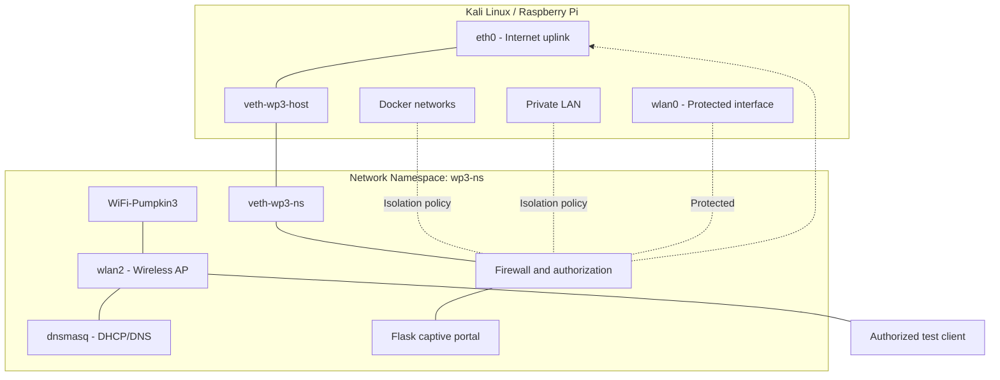
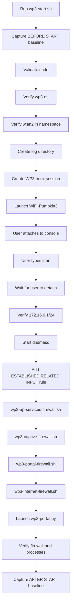
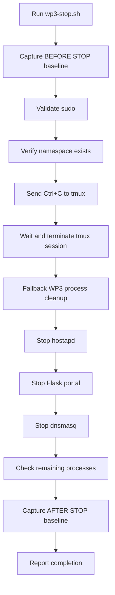

# WiFi-Pumpkin3 (WP3) — Architecture and Script Documentation

**Platform:** Kali Linux on Raspberry Pi  
**Project directory:** `/home/kali/wifipumpkin3`  
**Network namespace:** `wp3-ns`  
**Documentation status:** Initial architecture review — 21 November 2026

---

## 1. Project overview

The WP3 setup is organized into six functional areas:

1. Preparation and configuration
2. Network isolation infrastructure
3. Access point and DHCP/DNS services
4. Firewall and client authorization
5. Captive portal
6. Runtime lifecycle management and diagnostics

The architecture deliberately separates the WP3 application lifecycle from the underlying network isolation infrastructure.

**Important operational principle:** Starting or stopping WP3 should not create or destroy the network namespace, virtual interfaces, routes or isolation firewall infrastructure.

---

## 2. High-level architecture

*Conceptual topology based on the configuration and scripts reviewed. Actual packet forwarding and firewall behaviour still require verification.*

### 2.1 Network configuration

| Component | Value |
|---|---|
| AP interface | `wlan2` |
| Internet uplink | `eth0` |
| Protected interface | `wlan0` |
| Namespace | `wp3-ns` |
| Host veth | `veth-wp3-host` |
| Namespace veth | `veth-wp3-ns` |
| AP subnet | `172.16.0.0/24` |
| AP gateway | `172.16.0.1` |
| AP netmask | `255.255.255.0` |
| AP broadcast | `172.16.0.255` |
| DHCP pool | `172.16.0.100–172.16.0.150` |
| Transit subnet | `169.254.250.0/30` |
| Host transit IP | `169.254.250.1` |
| Namespace transit IP | `169.254.250.2` |
| DNS forwarders | `1.1.1.1`, `8.8.8.8` |

### 2.2 Protected networks

The central configuration identifies:

- Docker: `172.17.0.0/16`, `172.18.0.0/16`, `172.19.0.0/16`
- Private LAN: `192.168.0.0/24`
- Protected physical interfaces: `eth0`, `wlan0`

These protections must remain intact during future modifications.

---

## 3. Central configuration

### `wp3-isolation.conf`

This is intended to be the central configuration for the isolation toolkit.

| Lines | Section | Responsibility |
|---|---|---|
| 7–13 | Network interfaces | AP, uplink and protected interfaces |
| 15–21 | Namespace | Namespace and virtual Ethernet names |
| 23–34 | AP | SSID, channel, subnet, gateway and DHCP range |
| 36–41 | Transit | Host-to-namespace transit network |
| 43–50 | Docker | Protected Docker networks |
| 52–57 | Private LAN | Protected LAN subnets |
| 59–68 | Security | Internet authorization, LAN blocking and IPv6 isolation |
| 70–82 | Captive portal | Portal and authorized testing capabilities |
| 84–89 | BeEF | BeEF port and management restriction |
| 91–98 | Safety | Confirmation and preservation controls |
| 100–103 | Runtime paths | State and log directories |
| 105–108 | Initial state | Setup and runtime flags |

**Configuration concern:** Some AP values are duplicated in `wp3-configure-dhcp.sh` and other operational scripts. The intended future design is to use `wp3-isolation.conf` as the authoritative configuration source.

---

## 4. Script inventory

### 4.1 Preparation and configuration

| Script | Responsibility |
|---|---|
| `wp3-preflight.sh` | Preliminary system and interface readiness checks |
| `wp3-configure-dhcp.sh` | Network conflict checks and DHCP configuration |
| `wp3-audit.sh` | Broader system and network audit |

### 4.2 Network isolation

| File | Responsibility |
|---|---|
| `wp3-isolation.conf` | Central isolation configuration |
| `wp3-isolation-preflight.sh` | Checks prerequisites before isolation setup |
| `wp3-isolation-setup.sh` | Creates namespace, virtual links, routes and isolation infrastructure |
| `wp3-isolation-rollback.sh` | Reverses isolation setup and restores previous state |

### 4.3 Runtime services and firewall

| Script | Responsibility |
|---|---|
| `wp3-dnsmasq-start.sh` | Starts DHCP/DNS inside the namespace |
| `wp3-ap-services-firewall.sh` | AP-side DHCP and DNS firewall allowances |
| `wp3-internet-firewall.sh` | Internet forwarding and authorization policy |
| `wp3-authorize.sh` | Adds client authorization |
| `wp3-revoke.sh` | Removes client authorization |
| `wp3-captive-firewall.sh` | Captive HTTP redirection rules |
| `wp3-portal-firewall.sh` | Explicit portal access rules |

### 4.4 Captive portal

| File | Responsibility |
|---|---|
| `wp3-portal.py` | Flask captive portal application |
| `wp3-portal-start.sh` | Alternative/manual portal launcher |

### 4.5 Lifecycle and diagnostics

| Script | Responsibility |
|---|---|
| `wp3-start.sh` | Main runtime startup orchestrator |
| `wp3-stop.sh` | Stops application services |
| `wp3-verify.sh` | Independent operational verification |
| `wp3-capture-baseline.sh` | Captures diagnostic snapshots |

### 4.6 Core software patch

| File | Responsibility |
|---|---|
| `wp3-core-20261120.patch` | Changes to installed WP3 Python source |
| `wp3-core-20261120.patch.sha256` | Patch integrity checksum |

The core patch is separate from the operational scripts.

---

## 5. Startup architecture

### Main orchestrator: `wp3-start.sh`

The startup script is executed as the normal `kali` user.

### 5.1 Detailed startup sequence

| Order | Operation | Implementation |
|---|---|---|
| 1 | Capture before snapshot | `wp3-capture-baseline.sh` |
| 2 | Authenticate sudo | `sudo -v` |
| 3 | Verify namespace | `ip netns list` |
| 4 | Verify wireless interface | `ip netns exec wp3-ns ip link show wlan2` |
| 5 | Create log directory | `/var/log/wp3` |
| 6 | Launch WP3 | tmux session `wp3` |
| 7 | Start AP | User enters `start` |
| 8 | Verify AP gateway | `172.16.0.1/24` |
| 9 | Start DHCP/DNS | `wp3-dnsmasq-start.sh` |
| 10 | Permit return traffic | INPUT `ESTABLISHED,RELATED` |
| 11 | AP firewall | `wp3-ap-services-firewall.sh` |
| 12 | Captive redirection | `wp3-captive-firewall.sh` |
| 13 | Portal firewall | `wp3-portal-firewall.sh` |
| 14 | Internet policy | `wp3-internet-firewall.sh` |
| 15 | Start Flask portal | `wp3-portal.py` |
| 16 | Verify and snapshot | Firewall, process and baseline checks |

### 5.2 User interaction

The current startup procedure requires:

1. Run `bash ~/wifipumpkin3/wp3-start.sh`.
2. Press ENTER to attach to WP3.
3. Type `start`.
4. Wait until the AP starts.
5. Detach using Ctrl+B followed by D.
6. Allow the startup script to resume.

---

## 6. Shutdown architecture

### Main shutdown script: `wp3-stop.sh`

### 6.1 Services stopped

- WiFi-Pumpkin3
- hostapd
- Flask portal
- dnsmasq
- WP3 tmux session

### 6.2 Infrastructure preserved

- Network namespace
- Virtual Ethernet interfaces
- Routes
- Firewall rules
- Authorization state

**Important:** `wp3-stop.sh` does not delete `wp3-ns` or execute the isolation rollback script.

This allows WP3 to be stopped and restarted without recreating the underlying network isolation infrastructure.

---

## 7. Firewall architecture

The startup script currently applies firewall components in this order:

| Order | Firewall operation | Purpose |
|---|---|---|
| 1 | INPUT established/related | Allows established return traffic |
| 2 | AP services firewall | DHCP and DNS traffic |
| 3 | Captive firewall | HTTP redirection |
| 4 | Portal firewall | Explicit portal access |
| 5 | Internet firewall | Forwarding and authorization |

### Authorization model

The internet firewall creates and uses the `WP3_AUTH` chain.

The authorization scripts operate on that chain:

- `wp3-authorize.sh` adds authorization.
- `wp3-revoke.sh` removes authorization.

The exact rule semantics, insertion positions and NAT dependencies still need a detailed rule-by-rule review.

---

## 8. Baseline and logging architecture

The project uses a dedicated baseline capture utility:

`wp3-capture-baseline.sh`

It is called automatically:

- Before startup
- After startup
- Before shutdown
- After shutdown

The project also maintains runtime logs under `/var/log/wp3`.

Known log files include:

| Log | Purpose |
|---|---|
| `wifipumpkin3.log` | WP3 console output |
| `hostapd-debug.log` | hostapd output |
| `portal.log` | Flask captive portal output |
| `dnsmasq` log | DHCP/DNS diagnostic output |

These logs are important for diagnosing AP failures, DHCP assignment problems, DNS failures and portal behaviour.

---

## 9. Backup files

Historical backups currently include:

- `wp3-isolation-setup.sh.bak-before-transit`
- `wp3-isolation-rollback.sh.bak-before-transit`
- `wp3-ap-services-firewall.sh.bak-before-dns-replies`
- `wp3-portal.py.bak-before-captive-detection`
- `wp3-portal.py.bak-before-redirect-fix`
- `wp3-portal.py.bak-20261120-1608`
- `wp3-start.sh.bak-before-tmux`
- `wp3-stop.sh.bak-before-tmux`
- `wp3-start.sh.bak-before-dns-order-20261121-112200`
- `wp3-start.sh.bak-before-dns-order-20261121-112356`

These are historical copies, not part of the current normal startup sequence.

They should be retained until the current versions have been fully validated and the backup history documented.

---

## 10. Core WP3 source patch

`wp3-core-20261120.patch` contains modifications to the installed Python package.

The patch includes:

1. EOF handling in `terminal.py`.
2. Missing active DHCP service/reactor protection in `dhcpcontroller.py`.
3. Removal of broad iptables cleanup operations from the WP3 kill list in `wirelessmodecontroller.py`.
4. Null checking in `static.py`.
5. Synchronous cleanup and interface command execution in `static.py`.
6. Persistent hostapd stdout logging in `threads.py`.

The patch checksum was validated, and a reverse dry-run against the installed source succeeded.

The operational shell scripts are deliberately maintained separately from this patch.

---

## 11. Items requiring further investigation

The following items are not yet fully verified. They should not be treated as confirmed defects.

| Priority | Item | Required investigation |
|---|---|---|
| High | Isolation preflight | Inspect all checks and side effects |
| High | Isolation setup | Verify namespace, interface movement, routes and firewall creation |
| High | Isolation rollback | Verify restoration and safety checks |
| High | Firewall rules | Inspect individual chains, ordering and overlapping rules |
| Medium | Configuration ownership | Determine whether isolation scripts actually source `wp3-isolation.conf` |
| Medium | DHCP configuration | Remove duplicated hardcoded AP settings |
| Medium | SSID | Reconcile configured SSID with actual WP3 SSID |
| Medium | State flags | Determine whether setup flags are updated at runtime |
| Medium | Portal process detection | Verify process detection inside the namespace |
| Medium | Authorization | Audit exact authorize/revoke rule behaviour |
| Low | Historical backups | Identify obsolete versions and archive them |

---

## 12. Planned improvements

### Phase 1 — Documentation
- Complete isolation preflight documentation.
- Document isolation setup and rollback.
- Document firewall rule dependencies.
- Produce a definitive execution/dependency map.

### Phase 2 — Configuration consistency
- Make `wp3-isolation.conf` the central configuration source.
- Make `wp3-configure-dhcp.sh` interactive.
- Retain fixed AP subnet and gateway initially.
- Prompt for wireless interface, DHCP pool and lease settings.
- Preserve all existing safety checks and atomic updates.

### Phase 3 — Operational hardening
- Review startup and shutdown error handling.
- Improve process detection.
- Validate firewall idempotency.
- Confirm logging and recovery procedures.

### Phase 4 — Final documentation
- Produce a deployment procedure.
- Produce a startup/shutdown runbook.
- Produce an isolation recovery procedure.
- Maintain patch versions and checksums.

---

## 13. Current operational status

As of 21 November 2026:

- Network isolation infrastructure has been established.
- WP3 startup and shutdown scripts are available.
- The AP has successfully started.
- The iPhone test client has successfully accessed websites through the AP.
- DHCP/DNS and firewall ordering have been adjusted.
- Persistent hostapd diagnostic logging has been added.
- The core WP3 patch has been validated.

The latest successful AP test is encouraging, but long-duration stability remains under observation.

---

**Documentation boundary:** This document records the files and source code reviewed so far. The isolation preflight, isolation setup, rollback, detailed firewall contents and several utility scripts have not yet been inspected line by line. Those sections will be updated as the review progresses.

